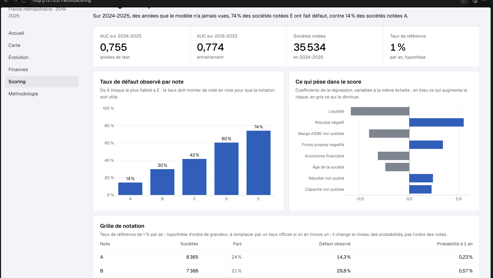
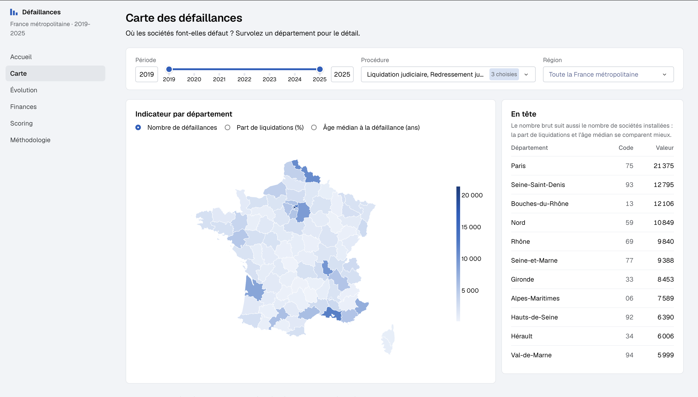
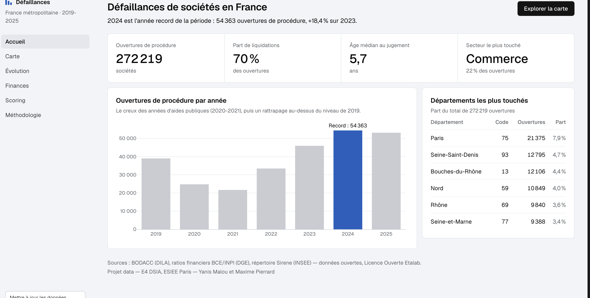
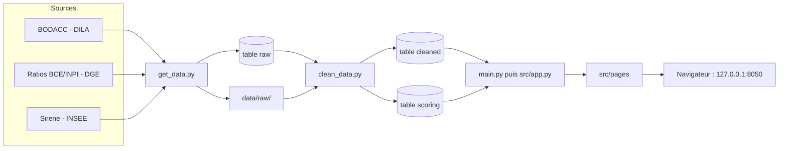
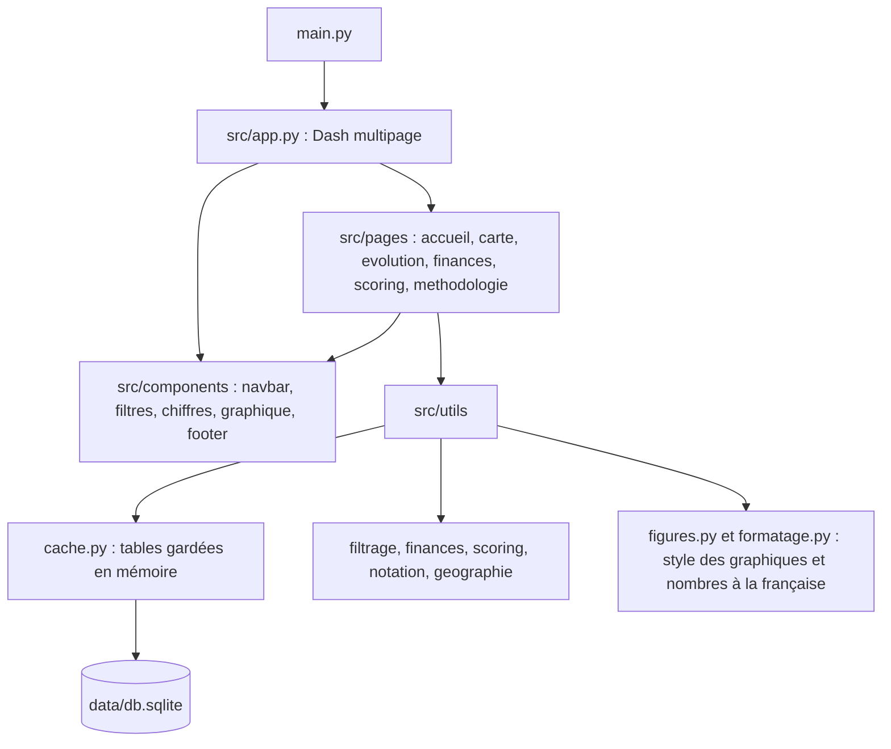

# Défaillances d'entreprises en France

Dashboard interactif sur les défaillances de sociétés en France métropolitaine (2019-2025), à partir des données ouvertes du BODACC, des ratios financiers BCE/INPI et de Sirene.

Projet data du cours Python 2 — E4 DSIA, ESIEE Paris.

**Auteurs** : Yanis Malou, Maxime Pierrard

**Question étudiée** : quels profils d'entreprises présentent le plus de risque de crédit ?

## Sommaire

1. [User Guide](#user-guide)
2. [Data](#data)
3. [Developer Guide](#developer-guide)
4. [Rapport d'analyse](#rapport-danalyse)
5. [Copyright](#copyright)

## User Guide

**Vidéo de démonstration** : [regarder la vidéo (2 min 58)](https://drive.google.com/file/d/1n6Xb5Yx17MKclBJKc5vNiwDDgNeBLg5D/view?usp=sharing)

### Installation

Il faut Python 3.13 ou plus récent et Git. La base de données déjà construite (`data/db.sqlite`) est fournie dans le dépôt : aucun téléchargement n'est nécessaire pour lancer le dashboard.

```bash
git clone https://github.com/Malouyanis/defaillances-entreprises.git
cd defaillances-entreprises
python -m pip install -r requirements.txt
python main.py
```

Avec [uv](https://docs.astral.sh/uv/), les deux lignes du milieu deviennent `uv sync` puis `uv run python main.py`.

Ouvrez ensuite <http://127.0.0.1:8050> dans un navigateur. Pour arrêter le dashboard : `Ctrl + C` dans le terminal.

### Les pages

| Page | Ce qu'elle montre |
|---|---|
| Accueil | Les chiffres clés, les ouvertures de procédure par année et les départements les plus touchés |
| Carte | Les défaillances par département : nombre, part de liquidations ou âge médian, avec le classement « En tête » |
| Évolution | Les ouvertures mois par mois pour chaque procédure, et le tableau année par année |
| Finances | Le chiffre d'affaires des sociétés défaillantes comparé à celui des sociétés saines, par secteur |
| Scoring | Le modèle de risque : AUC, taux de défaut par note de A à E, variables qui pèsent dans le score |
| Méthodologie | Les sources, les définitions, les choix de nettoyage et les limites |

Les pages Carte et Évolution ont une barre de filtres commune : période, procédure et région. La page Finances se filtre par secteur. Le bouton « Mettre à jour les données », en bas du menu, relit la base après un nouveau `clean_data.py`.







### Reconstruire les données (facultatif)

```bash
python get_data.py
python clean_data.py
```

`get_data.py` télécharge les trois sources (environ 1,5 Go, plusieurs minutes) dans `data/raw/` et écrit la table `raw` ; `clean_data.py` construit les tables `cleaned` et `scoring`. `python get_data.py 2024 2025` limite le téléchargement à une période plus courte.

## Data

### Sources

| Source | Producteur | Ce qu'on en tire |
|---|---|---|
| [BODACC, annonces commerciales](https://bodacc-datadila.opendatasoft.com/explore/dataset/annonces-commerciales/) | DILA | Les jugements d'ouverture de procédure collective (liquidation, redressement, sauvegarde) : date, département, nature du jugement |
| [Ratios financiers BCE/INPI](https://data.economie.gouv.fr/explore/dataset/ratios_inpi_bce/) | DGE, Bercy | Les comptes annuels déposés : chiffre d'affaires, résultat, EBE et ratios (liquidité, endettement, autonomie financière…) |
| [Base Sirene, stock des unités légales](https://www.data.gouv.fr/datasets/base-sirene-des-entreprises-et-de-leurs-etablissements-siren-siret/) | INSEE | Le profil de chaque société : catégorie juridique, secteur (code NAF), date de création, tranche d'effectifs |

Les trois sources sont des données publiques, sous [Licence Ouverte Etalab 2.0](https://www.etalab.gouv.fr/licence-ouverte-open-licence/). Elles se croisent par le **SIREN**, l'identifiant de chaque société.

### Périmètre

- Période : jugements de 2019 à 2025.
- France métropolitaine, Corse comprise (les départements d'outre-mer sont exclus).
- Sociétés uniquement : les entrepreneurs individuels sont exclus.
- Une défaillance = l'ouverture d'une liquidation judiciaire, d'un redressement judiciaire ou d'une sauvegarde. Une seule défaillance par société : la première ouverture de la période.

### Du brut au propre

1. **`get_data.py`** télécharge les fichiers bruts dans `data/raw/` (ignoré par Git) et écrit la table **`raw`** : les jugements d'ouverture du BODACC, avec leurs valeurs d'origine.
2. **`clean_data.py`** nettoie les trois sources et écrit deux tables :
   - **`cleaned`** : une ligne par société défaillante (272 219 lignes), avec son profil Sirene, son âge au jugement et, quand ils existent, ses derniers comptes. C'est la table du dashboard.
   - **`scoring`** : les défaillantes qui ont des comptes, plus un échantillon de sociétés saines décrites de la même façon (89 509 lignes, dont 40 045 défaillantes). C'est la table du modèle de risque.

Les choix de nettoyage principaux :

- **Seuls les jugements d'ouverture comptent** : une même procédure publie plusieurs annonces (ouverture, plan, clôture), on ne garde que la première.
- **L'âge est calculé à la date du jugement**, pas à aujourd'hui.
- **Le fichier stock Sirene** remplace l'API, qui ne tient pas le volume d'appels.
- **Les comptes sont ceux du dernier exercice clos avant le jugement**, et au plus deux ans avant (jointure « point-in-time ») : on ne regarde que ce qu'un prêteur aurait pu voir.
- **Les ratios sont ramenés entre leurs percentiles 1 et 99** pour limiter l'effet des valeurs extrêmes ; les comptes confidentiels gardent leurs ratios de bilan, mais leur chiffre d'affaires reste vide.
- **Les sociétés saines** sont des sociétés commerciales encore actives, tirées au hasard (graine fixe) ; chacune reçoit une date de référence tirée parmi les dates de jugement, pour être comparée à la même époque.

La base finale `data/db.sqlite` contient les trois tables `raw`, `cleaned` et `scoring`.

## Developer Guide

### Architecture

Le code est écrit en fonctions (programmation impérative) et rangé en trois paquets : `src/utils` (données et calculs), `src/components` (morceaux d'interface communs) et `src/pages` (une page Dash par fichier).





| Dossier ou fichier | Rôle |
|---|---|
| `main.py` | Point d'entrée : crée l'application et lance le serveur local |
| `get_data.py`, `clean_data.py` | Téléchargement des sources, puis construction des tables `cleaned` et `scoring` |
| `config.py` | Chemins, adresses des sources, période étudiée, hôte et port |
| `src/app.py` | Application Dash multipage : barre latérale, contenu de la page, pied de page |
| `src/pages/` | Une page par fichier, enregistrée avec `dash.register_page` |
| `src/components/` | Barre latérale, barre de filtres, carte des chiffres clés, graphique accessible, pied de page |
| `src/utils/` | Lecture de la base, nettoyage, jointure, calculs des pages, modèle de scoring, style des graphiques |
| `src/assets/` | Thème CSS et police Geist, servis automatiquement par Dash (aucune ressource en ligne) |
| `tests/` | Un fichier de test par module (`pytest`) |
| `DESIGN.md` | Règles visuelles du dashboard : couleurs, typographie, graphiques |

### Ajouter une page

1. Créer `src/pages/ma_page.py` et l'enregistrer : `dash.register_page(__name__, path="/ma-page", name="Ma page", order=50)`. Le numéro `order` place le lien dans le menu (Accueil 0, Carte 10, Évolution 20, Finances 30, Scoring 40, Méthodologie 90).
2. Définir une fonction `layout()` qui renvoie le contenu : elle est appelée à chaque visite, ce qui permet de lire la base à ce moment-là (avec `cache.charger_table`).
3. Pour réagir aux filtres, réutiliser `creer_barre_filtres()` de `src/components/filtres.py` et écrire un `@callback` qui prend les trois filtres en `Input`.
4. Ajouter `tests/test_ma_page.py` : récupérer le module de la page avec `sys.modules[page["module"]]` après `creer_application()`.

La page apparaît seule dans le menu : la barre latérale est construite à partir de `dash.page_registry`.

### Ajouter un graphique

1. Construire la figure Plotly, puis la passer à `appliquer_style(figure)` (`src/utils/figures.py`) : même police, mêmes couleurs, mêmes marges, nombres à la française.
2. Utiliser les couleurs du projet : `TEINTE` pour la donnée principale, `NEUTRE` pour la comparaison, `COULEURS_PROCEDURES` pour les trois procédures.
3. L'afficher avec `creer_graphique(description, figure=...)` (`src/components/graphique.py`) : la description donne les mêmes informations en texte pour les lecteurs d'écran.
4. Mettre les nombres affichés en forme avec `src/utils/formatage.py` (`entier`, `decimal`, `pourcentage`).

### Vérifier le code

```bash
uv sync --all-groups
uv run pytest
uv run ruff check .
uv run mypy .
uv run pylint src/utils
```

## Rapport d'analyse

Tous les chiffres ci-dessous sortent de la base `data/db.sqlite` du dépôt ; les pages du dashboard les recalculent à chaque visite.

### 1. Combien de défaillances, et quand ?

*À voir dans le dashboard : page Évolution, graphique « Ouvertures de procédure par mois » (le creux de 2021 et le record de 2024) et tableau « Par année ».*

Entre 2019 et 2025, **272 219 sociétés** ont connu une défaillance en France métropolitaine.

| Année | 2019 | 2020 | 2021 | 2022 | 2023 | 2024 | 2025 |
|---|---|---|---|---|---|---|---|
| Ouvertures | 38 983 | 24 744 | 21 650 | 33 432 | 45 924 | 54 363 | 53 123 |

- **Le creux de 2020-2021** : en 2021, les défaillances étaient 44,5 % moins nombreuses qu'en 2019. Cette baisse s'explique notamment par le ralentissement de l'activité des tribunaux pendant le premier confinement et par les aides publiques (prêts garantis par l'État, chômage partiel), qui ont permis à certaines entreprises de retarder leur défaillance.
- **Le rattrapage** : à partir de 2023, les défaillances dépassent leur niveau de 2019. L'année 2024 marque un record avec 54 363 défaillances (+39,5 % par rapport à 2019), et le niveau reste élevé en 2025 (+36,3 % par rapport à 2019).
- **Chaque mois d'août** connaît une forte baisse (2,6 % des ouvertures de l'année, contre environ 9 % pour un mois classique). Cela s'explique surtout par les vacances judiciaires et non par une amélioration de la situation économique.

### 2. Quelles sociétés ?

*À voir dans le dashboard : page Carte, indicateurs « Part de liquidations (%) » et « Âge médian à la défaillance (ans) » avec le classement « En tête », et page Accueil, « Départements les plus touchés ».*

- **70,1 % des ouvertures concernent des liquidations directes**, contre 27,2 % de redressements et 2,7 % de sauvegardes. Cela montre que beaucoup de sociétés arrivent devant le tribunal alors que leur situation est déjà très difficile à redresser.
- **L'âge médian au moment du jugement est de 5,7 ans** : cela signifie que la moitié des sociétés concernées avaient moins de six ans au moment de leur défaillance.
- **Trois secteurs regroupent plus de la moitié des défaillances** : le commerce représente 22,2 %, la construction 21,2 % et l'hébergement-restauration 13,7 %.
- **Départements** : Paris arrive en tête avec 21 375 ouvertures, suivi de la Seine-Saint-Denis (12 795) et des Bouches-du-Rhône (12 106). Ces écarts s'expliquent aussi par le nombre de sociétés présentes dans chaque département. Pour comparer réellement les territoires, la part de liquidations et l'âge médian affichés sur la carte sont donc plus intéressants que les nombres bruts.

### 3. Quels signaux financiers annonçaient la défaillance ?

*À voir dans le dashboard : page Finances, graphique « Répartition du chiffre d'affaires » et tableau « Statistiques par groupe », filtrables par secteur.*

Dans la table `scoring`, nous avons comparé les variables financières pour voir lesquelles permettent le mieux de distinguer les sociétés défaillantes des sociétés saines. Pour cela, nous utilisons l'AUC univariée : une valeur de 0,5 signifie que la variable ne permet pas vraiment de faire la différence, tandis qu'une valeur de 1 correspond à une séparation parfaite.

| Variable (derniers comptes) | Pouvoir discriminant | Chez les défaillantes |
|---|---|---|
| Résultat net | 0,719 | plus bas |
| Ratio de liquidité | 0,711 | plus bas |
| Marge d'EBE | 0,693 | plus basse |
| Autonomie financière | 0,682 | plus basse |

**Le chiffre d'affaires**, lui, permet moins de distinguer les deux groupes : sa médiane est de **307 221 €** chez les sociétés défaillantes, contre **330 000 €** chez les sociétés saines. La différence est surtout visible parmi les plus grandes entreprises : **8,4 % des sociétés saines dépassent 10 M€ de chiffre d'affaires, contre 3,9 % des défaillantes**. La taille de l'entreprise joue donc un rôle, mais la rentabilité et la trésorerie semblent être des indicateurs plus intéressants pour anticiper une défaillance.

### 4. Le modèle de scoring

*À voir dans le dashboard : page Scoring, graphiques « Taux de défaut observé par note » et « Ce qui pèse dans le score », puis la « Grille de notation ».*

Nous avons utilisé une **régression logistique** pour estimer la probabilité qu'une société fasse défaut à partir de ses derniers comptes financiers. Le modèle prend notamment en compte la liquidité, l'autonomie financière, les fonds propres négatifs, l'endettement, la marge d'EBE, le résultat négatif et la capacité de remboursement. L'âge et le secteur d'activité sont également intégrés. L'entraînement se fait sur les années **2019-2023** (53 975 sociétés), puis les performances sont évaluées sur **2024-2025** (35 534 sociétés), qui n'ont pas été utilisées pendant l'apprentissage.

- **AUC : 0,774 sur l'entraînement et 0,755 sur le test.** Les résultats sont assez proches entre les deux périodes, ce qui montre que le modèle conserve de bonnes performances sur des données qu'il n'a pas utilisées pour apprendre.
- **Les variables qui influencent le plus le score** (après mise à la même échelle) sont une faible liquidité (coefficient −0,591), un résultat négatif (+0,550), des fonds propres négatifs (+0,340), une faible autonomie financière (−0,318) et l'âge de la société (−0,243 : plus elle est ancienne, plus le risque diminue). Le secteur de la construction augmente également le risque de manière importante.

Les probabilités obtenues sont ensuite **recalées** pour correspondre à un taux de défaut annuel de référence de 1 %. Cette étape est nécessaire car le modèle a été entraîné sur un échantillon dans lequel presque une société sur deux était défaillante. Enfin, les sociétés sont réparties en **cinq notes, de A à E**, en fonction des quintiles de l'échantillon d'entraînement :

| Note | Sociétés (2024-2025) | Taux de défaut observé | Probabilité recalée moyenne |
|---|---|---|---|
| A | 8 365 | 14,3 % | 0,23 % |
| B | 7 386 | 29,8 % | 0,57 % |
| C | 7 484 | 41,6 % | 0,91 % |
| D | 6 379 | 60,5 % | 1,65 % |
| E | 5 920 | 74,2 % | 6,01 % |

**Le taux de défaut augmente progressivement de la note A à la note E** : cela montre que le modèle parvient à classer les sociétés selon leur niveau de risque, y compris sur les années qui n'ont pas servi à son entraînement.

### 5. Limites

*Le détail des sources, des définitions et des choix de nettoyage : page Méthodologie.*

- **Biais de sélection** : seulement 14,7 % des sociétés défaillantes disposent de comptes clôturés dans les deux années précédant leur jugement. L'analyse financière repose donc uniquement sur les entreprises pour lesquelles ces informations sont disponibles.
- **Biais du survivant** : les sociétés considérées comme saines sont encore actives aujourd'hui. Elles ont donc nécessairement survécu jusqu'à présent, ce qui peut rendre la comparaison avec les sociétés défaillantes un peu trop favorable.
- **Le taux de référence de 1 % reste une hypothèse** utilisée pour calibrer le modèle, et non une statistique officielle. La Banque de France publie le nombre de défaillances, mais pas un taux de défaut. Ce choix influence les probabilités obtenues, mais ne change pas le classement des sociétés par note.
- **La carte présente des nombres bruts de défaillances** : comme nous ne disposons pas du nombre total de sociétés pour chaque département, il n'est pas possible de calculer un véritable taux de défaillance local.

### 6. Qualité du code

90 tests automatiques (`pytest`), 0 erreur de types (`mypy`), une note `pylint` de 9,99/10 sur `src/utils`, une complexité moyenne de classe A (`radon`) et un code formaté par `ruff`.

## Copyright

*Déclaration des auteurs : nous déclarons sur l'honneur que le code de ce projet a été conçu, écrit et développé par nous-mêmes. Nous avons utilisé l'intelligence artificielle comme outil d'accompagnement tout au long du projet, sans lui déléguer la réalisation du travail à notre place.*

**Auteurs :** Maxime Pierrard et Yanis Malou.

### Usage de l'intelligence artificielle

Nous avons utilisé Claude (Anthropic) comme assistant tout au long du projet. Il nous a notamment aidés à nous orienter lorsque nous rencontrions des difficultés, à mieux comprendre certaines notions techniques, à identifier et corriger des erreurs dans notre code et à améliorer sa lisibilité grâce à des commentaires et des explications.

Au début du projet, Claude nous a également aidés à explorer les différentes sources de données disponibles et à identifier celles qui correspondaient le mieux à notre sujet.

**La conception et le développement du projet restent notre travail.** Nous avons nous-mêmes réalisé les différentes missions, écrit et intégré le code, effectué les tests, vérifié les résultats sur les données et pris les décisions concernant les méthodes utilisées. Les propositions de Claude ont été examinées, adaptées et testées avant d'être intégrées au projet.

Nous avons principalement utilisé Claude pour les besoins suivants :

**Compréhension et recherche des données**

- Explorer les sources de données disponibles sur les défaillances d'entreprises et identifier celles qui pouvaient répondre à notre problématique.
- Comprendre la structure des fichiers, les différentes variables et les relations entre les bases.
- Identifier les limites des sources et vérifier la cohérence des données utilisées.

**Développement et organisation du projet**

- Réfléchir à l'organisation des dossiers et à la répartition des fonctionnalités entre les différents fichiers Python.
- Nous orienter sur les bibliothèques et les fonctions adaptées aux besoins du projet.
- Obtenir des explications sur certaines parties du code lorsque leur fonctionnement n'était pas évident.

**Débogage et qualité du code**

- Identifier l'origine de certaines erreurs et comprendre pourquoi elles apparaissaient.
- Corriger des problèmes rencontrés pendant le développement et les tests.
- Améliorer la lisibilité du code, notamment en ajoutant des commentaires et en simplifiant certaines parties lorsque cela était pertinent.

**Analyse et modélisation**

- Discuter des choix statistiques et des méthodes à utiliser pour analyser les défaillances.
- Comprendre le fonctionnement de la régression logistique et du modèle de scoring.
- Vérifier la cohérence des résultats obtenus et mieux interpréter les indicateurs utilisés.

### Exemples de questions posées à l'IA

Voici quelques exemples de demandes formulées au cours du projet. Elles ont été regroupées par thème et reformulées pour en faciliter la lecture. Il ne s'agit donc pas nécessairement de retranscriptions mot pour mot des échanges.

**Recherche et compréhension des données**

- « Nous souhaitons étudier les défaillances d'entreprises en France entre 2019 et 2025. Quelles sources de données ouvertes pourraient nous permettre de récupérer les jugements de défaillance et des informations financières sur les sociétés ? »
- « Nous avons plusieurs fichiers provenant de sources différentes. Comment identifier les variables utiles et faire le lien entre les données financières et les informations relatives aux défaillances ? »
- « Notre enseignant nous demande d'intégrer une variable financière continue, notamment le chiffre d'affaires. Quelles sources pourraient nous permettre de récupérer cette information et comment vérifier sa disponibilité ? »

**Organisation et développement**

- « Nous développons notre projet avec Python et Dash. Comment organiser les fichiers pour séparer la récupération des données, leur traitement, les calculs et les différentes pages du tableau de bord ? »
- « Nous souhaitons éviter de répéter les mêmes traitements dans plusieurs parties du projet. Comment organiser nos fonctions pour qu'elles puissent être réutilisées proprement ? »
- « Peux-tu nous expliquer cette fonction et nous aider à comprendre comment elle interagit avec les autres fichiers du projet ? »

**Analyse statistique et visualisation**

- « Nous voulons comparer les défaillances selon les secteurs d'activité, les années et les départements. Quels indicateurs seraient les plus pertinents pour faire ressortir les différences ? »
- « Comment interpréter les écarts entre les sociétés défaillantes et les sociétés saines à partir de leurs ratios financiers ? »
- « Nous souhaitons présenter les résultats dans un tableau de bord interactif. Quels types de graphiques seraient les plus adaptés pour représenter l'évolution des défaillances et les différences entre les entreprises ? »

**Modélisation et scoring**

- « Nous souhaitons construire un modèle de scoring permettant d'estimer le risque de défaillance d'une entreprise à partir de ses données financières. Quelle approche statistique serait adaptée à notre problématique ? »
- « Comment séparer les données d'entraînement et de test par années pour vérifier que notre modèle fonctionne sur des données qu'il n'a jamais utilisées pendant son apprentissage ? »
- « Nous souhaitons transformer les probabilités obtenues en cinq catégories de risque, de A à E. Comment construire cette notation et comment interpréter les résultats ? »
- « Notre échantillon d'entraînement contient une proportion de sociétés défaillantes très différente de celle observée dans la réalité. Comment prendre en compte cette différence pour obtenir des probabilités plus représentatives ? »

**Débogage et amélioration**

- « Nous rencontrons cette erreur lors de l'exécution de notre code. Peux-tu nous aider à identifier son origine, expliquer pourquoi elle apparaît et proposer une correction sans modifier le fonctionnement attendu ? »
- « Peux-tu relire cette fonction, nous signaler les éventuelles erreurs et proposer des améliorations pour la rendre plus lisible et plus facile à maintenir ? »
- « Nous souhaitons ajouter des commentaires pour faciliter la compréhension du code. Peux-tu nous aider à expliquer les différentes étapes sans surcharger les fonctions de commentaires inutiles ? »

### Prompts structurants

Certaines demandes ont davantage orienté les grandes étapes du projet. Voici les principaux prompts utilisés, regroupés et reformulés pour rester fidèles à notre démarche.

**1. Définition du projet**

« Nous réalisons un projet de data science en binôme avec Python. Notre sujet porte sur les défaillances d'entreprises en France, avec une approche orientée risque de crédit. Nous souhaitons étudier les profils d'entreprises les plus exposés aux défaillances sur la période 2019-2025. Aide-nous à définir le périmètre de l'étude, les indicateurs pertinents et les sources de données à privilégier. »

**2. Recherche d'une donnée financière**

« Notre enseignant souhaite que nous intégrions une véritable variable financière continue, notamment le chiffre d'affaires. Nous devons pouvoir justifier la provenance des données utilisées. Aide-nous à identifier une source adaptée, à comprendre sa structure et à vérifier comment l'associer aux données de défaillance. »

**3. Organisation et répartition du travail**

« Nous travaillons à deux sur le même dépôt GitHub. Nous souhaitons organiser le développement en missions distinctes, répartir les tâches et utiliser des branches pour éviter de travailler directement sur main. Aide-nous à définir une organisation claire avec des commits et des pull requests. Explique les modifications proposées afin que nous puissions les comprendre et les défendre. »

**4. Développement des fonctionnalités**

« Nous allons travailler sur une fonctionnalité précise : [description de la mission]. Aide-nous à identifier les étapes nécessaires, à comprendre les fonctions à utiliser et à anticiper les éventuels problèmes. Nous voulons pouvoir développer, exécuter et tester nous-mêmes chaque partie avant de l'intégrer au projet. »

**5. Identité visuelle et tableau de bord**

« Nous développons un tableau de bord interactif avec Dash et Plotly pour présenter notre analyse des défaillances d'entreprises. Nous souhaitons une interface sobre, professionnelle et cohérente avec un sujet lié à la banque et à la finance. Propose des pistes graphiques et aide-nous à améliorer l'expérience utilisateur sans complexifier inutilement le projet. »

**6. Construction du modèle de scoring**

« Nous souhaitons construire un modèle permettant d'estimer la probabilité de défaillance d'une entreprise à partir de ses caractéristiques financières. Aide-nous à choisir une méthode adaptée, à définir les variables pertinentes et à organiser l'entraînement et le test sur des périodes distinctes. Nous souhaitons également construire une notation de A à E permettant de classer les entreprises selon leur niveau de risque. »

**7. Vérification et qualité du code**

« Nous souhaitons vérifier la qualité globale de notre projet avant de le rendre. Aide-nous à identifier les erreurs éventuelles, les problèmes de lisibilité et les points à améliorer à partir des outils de vérification utilisés dans le projet. Les corrections doivent préserver les résultats et le fonctionnement de l'application. »


### Données et ressources

- Données : BODACC (DILA), ratios financiers BCE/INPI (DGE), base Sirene (INSEE), sous [Licence Ouverte Etalab 2.0](https://www.etalab.gouv.fr/licence-ouverte-open-licence/).
- Contours des départements : `data/departements.geojson`, issu d'Admin Express (IGN), Licence Ouverte Etalab 2.0.
- Police : [Geist](https://github.com/google/fonts/tree/main/ofl/geist), sous SIL Open Font License (`src/assets/fonts/OFL.txt`).
- Bibliothèques : Dash, Plotly, pandas, scikit-learn, requests, pyarrow, sous leurs licences respectives.
